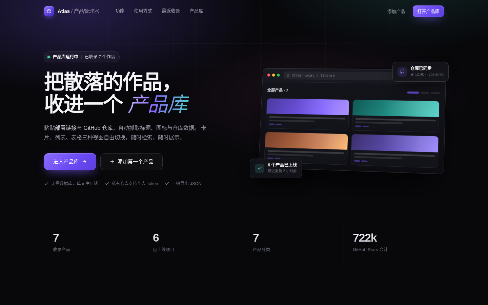

# Atlas · 产品管理器

把散落在各处的作品收进一个可检索的产品库：粘贴**部署链接**和 **GitHub 仓库**，自动抓取站点信息与仓库数据，用**卡片 / 列表 / 表格**三种视图展示。适合管理用 AI 或手工开发、已经部署上线的网站项目。



## 功能

| 能力 | 说明 |
| --- | --- |
| 链接即录入 | 粘贴部署地址，自动读取网页标题、描述、favicon 与 og:image |
| GitHub 联动 | 同步 Star / Fork / 主要语言 / 最近提交；私有仓库支持个人 Token |
| 三种视图 | 卡片、列表、表格自由切换，选择会记住 |
| 检索与筛选 | 关键词搜索（⌘K / Ctrl+K 聚焦）、分类、标签、状态、精选 |
| 详情即预览 | 详情页内嵌线上站点，被 X-Frame-Options 拒绝时自动兜底提示 |
| 状态管理 | 已上线 / 内测中 / 开发中 / 已归档，支持精选标记 |
| 数据自持 | 单文件 `data/products.json`，无数据库依赖，可导出、可版本管理 |

## 快速开始

```bash
npm install
npm start
# 打开 http://localhost:3000
```

首次启动会自动写入 7 条示例数据（真实开源项目），并异步补全 GitHub 数据与站点图标，可以直接删除。

环境变量：

| 变量 | 默认 | 说明 |
| --- | --- | --- |
| `PORT` | `3000` | 服务端口（平台通常注入 `8000`） |
| `HOST` | `0.0.0.0` | 监听地址 |
| `DATA_DIR` | 项目 `data/` | 数据目录；只读环境会自动退到系统临时目录 |
| `GITHUB_TOKEN` | 空 | 服务端全局 GitHub Token，可提高限额并读取私有仓库 |

## 目录结构

```
.
├── server.js              # Express 服务：CRUD / 元信息抓取 / GitHub 代理 / 图标代理
├── data/products.json     # 全部数据（首次运行自动生成）
├── public/
│   ├── index.html         # 首页介绍
│   ├── app.html           # 产品库（三视图 + 添加/编辑弹窗）
│   ├── product.html       # 产品详情（内嵌预览 + 仓库数据）
│   └── assets/
│       ├── style.css      # 设计系统
│       ├── core.js        # 图标、工具函数、API、卡片渲染
│       ├── landing.js     # 首页逻辑
│       ├── library.js     # 产品库逻辑
│       └── detail.js      # 详情页逻辑
└── docs/                  # 截图
```

## 添加一个产品

1. 进入「产品库」→ 右上角**添加产品**。
2. 填入部署链接，点**自动抓取**：名称、简介、图标、封面会自动回填（可再修改）。
3. 填入 GitHub 仓库，点**同步仓库**：Star、Fork、语言、最近提交自动写入。
4. 选择分类 / 状态、加标签与技术栈，保存即可。

## 私有仓库怎么配置

匿名调用 GitHub 接口只能读公开仓库，且每小时限 60 次。读取私有仓库需要个人令牌：

1. GitHub → **Settings → Developer settings → Personal access tokens**，创建一个带 `repo` 权限的 Token（fine-grained token 需勾选目标仓库的 Contents 读取权限）。
2. 在产品库左下角进入 **设置与 Token**，粘贴并保存。
3. 回到产品表单，打开「这是私有仓库」开关，再点**同步仓库**。

Token 只存在浏览器 `localStorage`，请求时通过 `x-github-token` 头发给本服务，再转给 GitHub，**不会写入 `data/products.json`**。

如果是单人部署，也可以把 Token 放到服务端环境变量 `GITHUB_TOKEN`，这样所有访问者都不需要单独配置；多人共用时建议用浏览器端方案。

## 部署

### Trae 一键部署

项目已带部署脚本，可直接用 Trae 插件市场的「一键部署」：

1. Trae 左侧插件市场搜索 **一键部署**，点「使用」。
2. 选择本项目目录，运行时选 **Node.js 20**。
3. 构建命令 `sh build.sh`，启动命令 `sh run.sh`，端口 `8000`。
4. 点击部署，拿到公网地址即可分享。

命令行部署可直接复用 [`deploy.execution.json`](deploy.execution.json)（`nodejs20` + `build.sh` / `run.sh` / 端口 `8000`）。

构建产物是自包含的 `dist/`：`server.js`、`public/`、`data/`、`package.json`、`run.sh` 与生产依赖。部署环境的项目目录是只读的，服务会尝试写 `data/`，失败后自动切到系统临时目录并复用随包分发的示例数据；因此线上的增删改属于演示性质，**服务重启或重新部署后会恢复初始 7 条样例**。需要长期保存请自建服务器并挂载 `data/`。

### 直接跑

```bash
PORT=8080 GITHUB_TOKEN=ghp_xxx node server.js
```

建议用 pm2 守护：

```bash
npm i -g pm2
pm2 start server.js --name atlas
pm2 save
```

### Docker

```bash
docker build -t atlas .
docker run -d -p 3000:3000 -v $(pwd)/data:/app/data --name atlas atlas
```

`data/` 必须挂载出来，否则重建容器会丢数据。

### Nginx 反向代理

```nginx
server {
  listen 80;
  server_name atlas.example.com;

  location / {
    proxy_pass http://127.0.0.1:3000;
    proxy_set_header Host $host;
    proxy_set_header X-Real-IP $remote_addr;
  }
}
```

> 注意：服务需要 Node 运行时（接口依赖服务端抓取与 JSON 落盘），不能直接丢到纯静态托管（GitHub Pages / OSS 静态网站）上。Vercel 等平台需要把 `server.js` 改造成 Serverless Function，并把存储换成数据库。

## API

| 方法 | 路径 | 说明 |
| --- | --- | --- |
| GET | `/api/products?q=&category=&tag=&status=&featured=1&sort=updated` | 列表 + 统计 |
| GET | `/api/products/:id` | 单个产品 |
| POST | `/api/products` | 新建 |
| PATCH | `/api/products/:id` | 更新（局部字段） |
| DELETE | `/api/products/:id` | 删除 |
| GET | `/api/meta?url=` | 抓取网页标题 / 描述 / 图标 / og:image |
| GET | `/api/github?repo=` | 仓库信息（可带 `x-github-token` 头） |
| GET | `/api/icon?url=` | favicon 同源代理（带缓存） |
| GET | `/api/stats` | 统计 |
| GET | `/api/health` | 健康检查（状态、存储模式、产品数） |
| GET | `/api/export` | 导出整份 JSON |

`sort` 可选：`updated`（默认）、`created`、`stars`、`name`。

## 常见问题

**详情页预览一片空白？**
目标站点设置了 `X-Frame-Options: DENY/SAMEORIGIN` 或 CSP `frame-ancestors`，浏览器不允许被嵌入。页面会在 7 秒后自动显示兜底面板，点「在新窗口打开」即可。GitHub、Google 等站点都属于这种情况。

**GitHub 提示限流？**
匿名接口每小时 60 次。配置 Token 后按令牌额度计算，或在设置里稍后再试（结果有 10 分钟缓存）。

**图标显示成首字母？**
说明站点没有可访问的 favicon，或代理抓取失败。这是预期降级，不影响使用；也可以在编辑时手动填封面图。

**数据存在哪？**
本地默认写入 `data/products.json`，直接备份这个文件即可；也可以访问 `/api/export` 下载。Trae 一键部署的线上环境只读，数据会暂存在临时目录，服务重启后恢复示例数据——产品库会显示「演示环境」提示。
